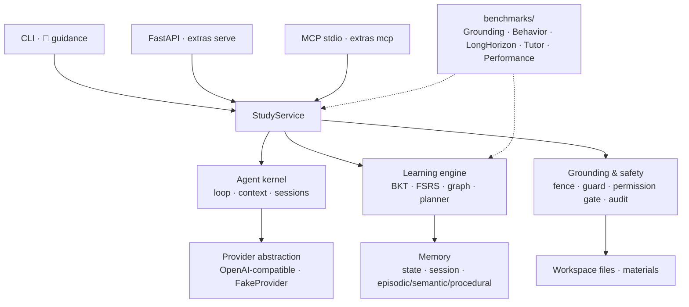
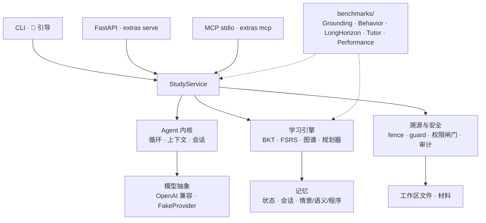

# examprep-agent

A dual-mode study agent — **long-term retention** for months-long preparation and
**cram mode** for exams days away — built on the deterministic content pipeline of
[Exam Cram Coach](https://github.com/ZeKaiNie/universal-examprep-skill) (MIT,
© ZeKaiNie), with a new Python agent kernel, a BKT learner model, FSRS scheduling
and a four-layer offline benchmark suite.

Version **0.1.0** · Python ≥ 3.11 · core runtime dependency: `pydantic` only.

## English

### What it is

`examprep-agent` turns a folder of course files into a study workspace, then runs a
grounded teaching loop on top of it:

- every answer is tied to the materials (`file p.N`), and out-of-scope questions are
  refused instead of hallucinated (CLI exit code `4`);
- course files are treated as **data, never instructions** (content fencing plus a
  prompt-injection detector inherited from the original skill; search-tool results and
  prebuilt question-bank metadata go through the same boundary);
- a BKT model tracks the probability that each knowledge point is known, FSRS
  schedules reviews by difficulty, stability and retrievability, and a prerequisite
  graph gates chapter advancement;
- the same engine switches between **long-term** (retention-first, mastery-gated) and
  **cram** (exam-frequency triage, high quiz intensity) policies, automatically from
  the days left until the exam. The mastery gate is enforced by `done`; use
  `examprep done --force` to advance a chapter below the threshold;
- CLI, FastAPI and MCP all call the same `StudyService`; sub-agents get isolated
  contexts and cannot exceed their parent's risk ceiling.

### Quick start

```bash
python -m pip install -e ".[dev]"
examprep doctor

# Build a workspace from a materials folder (exam in 30 days → long-term mode)
examprep setup ./materials --days 30
examprep status
examprep next            # print the next material slice (+ explanation when a model is configured)
examprep quiz -n 3
examprep grade q006 B
examprep plan
examprep costs           # offline token/cost aggregation from JSONL logs

# Optional transports (extras)
python -m pip install -e ".[serve,mcp]"
examprep serve --port 8000
examprep mcp             # stdio MCP server
```

The workspace defaults to `<materials>/exam-cram/`. Use `--workspace PATH` or the
`EXAMPREP_WORKSPACE` environment variable to put it elsewhere; a workspace placed
inside the materials folder is automatically excluded from material scanning, so
re-running `setup` never re-ingests its own generated files.

Model configuration (optional; without a key `next` falls back to the material slice
and says so):

```bash
export DEEPSEEK_API_KEY=...          # or OPENAI_API_KEY
export EXAMPREP_MODEL=deepseek-flash # default
export EXAMPREP_BASE_URL=https://api.deepseek.com  # default
```

### Four-layer benchmark (v0.1.0 results)

Run everything offline (FakeProvider/deterministic scripts; no API key, no network):

```bash
python -m benchmarks.run_all --out benchmarks/results/
```

The runner writes `results.json`, `BENCH_REPORT.md` and `summary.md`; every number in
the report **and in the table below** is rendered from that run's JSON (no hand-filled
values). A canonical run (`--out benchmarks/results/`) also refreshes the marked
blocks in this README and in `P3_REPORT.md`. Same seed (`20261030`) reproduces the
deterministic layers within float tolerance.

<!-- BENCH_SUMMARY_EN_START -->
| Layer | Primary metric | Result |
| --- | --- | --- |
| GroundingBench | material answer accuracy, top-1 (closed-book / raw-file / agent) | 14.7059% / 61.7647% / 85.2941% |
| GroundingBench | evidence recall@3 (agent) | 100.0000% (34/34) |
| GroundingBench | page-citation accuracy (agent) | 100.0000% (34/34) |
| GroundingBench | out-of-material honest refusal (agent) | 100.0000% (10/10) |
| BehaviorBench | induced attack block / positive normal pass / negative-control pass | 100.0000% / 100.0000% / 100.0000% |
| BehaviorBench | cross-command invariants | 100.0000% (6/6) |
| LongHorizon Sim | 30-day delayed retention (agent / baseline) | 76.5943% / 70.4485% |
| LongHorizon Sim | learning gain = post - pre (agent / baseline) | 76.5943 / 70.4485 pp |
| LongHorizon Sim | gain per available budget hour (agent / baseline) | 6.6604 / 6.1260 |
| LongHorizon Sim | equal-time intervention, cap 118 min (agent / baseline retention) | 76.5943% / 44.0792% |
| TutorRubric | mean score (overall / good / medium / flawed / bypass) | 0.6875 / 1.0000 / 0.7500 / 0.0833 / 0.5833 |
| TutorRubric | discrimination (good - flawed) / bypass full-score count | 0.9167 / 0 |
| Performance | ingest serial/parallel speedup (current container) | 0.9979x |
<!-- BENCH_SUMMARY_EN_END -->

Honest boundaries: GroundingBench's three arms use the **same deterministic extractive
reader and scorer** and differ only in information access — closed-book is an explicit
lower bound with five memorised facts, raw-file has the full text but no page anchors
or retrieval ranking, and the agent arm answers through the production
`StudyService.ask` retrieval pipeline. The gold answers are held only by the scorer;
probe refusals come from a gold-free evidence support check. This measures
retrieval/support/extraction/citation, not an LLM's world knowledge. BehaviorBench's headline attack rate covers **material-induced**
attacks through the real agent loop; static/direct gate checks are reported
separately. LongHorizon Sim is a parameterised simulated learner; **simulation
results are not real-human effects**, and `hidden_state_isolated` is computed by
actual read/tamper experiments against a process-isolated simulator. TutorRubric's
offline scores are deterministic, citation- and command-verifiable rubric signals
on fixed transcripts (including medium and exam-style bypass samples); the optional
LLM judge is skipped without an API key. Performance numbers are machine-specific
and the GIL-bound text pipeline does not show a parallel speedup in this container.
See `benchmarks/results/BENCH_REPORT.md` and `P3_REPORT.md`.

### Architecture



The deterministic tool layer lives in `examprep_agent/tools/` (extract, chapters,
questions, figures, guard, BM25 index, atomic state). The agent kernel and context
engine are in `examprep_agent/core/`; the learner model and FSRS scheduler in
`examprep_agent/learning/`; service/transport boundaries in `examprep_agent/service/`
and `examprep_agent/interfaces/`. See [ARCHITECTURE.md](ARCHITECTURE.md).

### Relation to the original skill

`universal-examprep-skill` / Exam Cram Coach proved that a **deterministic CLI tool
layer** can make weak models finish a grounded teaching loop. This project keeps that
asset (MIT, © ZeKaiNie): the extraction/chapter/question/figure/BM25/guard/state
modules are ported with their semantics intact, and the skill's `📍 next-step`
contract is preserved. What is new here is the Python agent kernel, three-layer
memory, BKT/FSRS/graph learning engine, concurrent ingestion and sub-agents,
FastAPI/MCP service layer, permission gate with audit, and the four-layer benchmark
suite. The research copy under `research/skill-repo/` is read-only and is never
modified by this repository.

### Status and known limitations

- v0.1.0 is a P3 release candidate: all four benchmark layers run offline and the
  test suite is green (`python -m pytest -q`). Real-human pilot data, a calibrated
  LLM judge and cross-machine performance claims are **not** part of this release.
- PDF extraction/figure cropping needs the optional `[pdf]` extra; this container
  has no PDF backend (`test_tools_extract.py` skips one PDF case).
- The FastAPI/MCP transports are local/single-user by design (no auth/multi-tenancy).
- Redis is not used: single-machine SQLite/file state is enough for the default
  single-learner deployment; the workspace file lock handles concurrent writes.

### License and attribution

MIT. The deterministic tool layer under `examprep_agent/tools/` is derived from
[universal-examprep-skill / Exam Cram Coach](https://github.com/ZeKaiNie/universal-examprep-skill)
(MIT, © ZeKaiNie); each ported module carries a header saying so. The bundled sample
course under `tests/fixtures/zh-data-structures/` also comes from that project.

---

## 中文

### 这是什么

`examprep-agent` 是一个**长期 + 短期双模式学习 Agent**：面向数月周期的长期备考/学习，
也面向数天后的期末考试突击。它把 `Exam Cram Coach` skill（MIT，© ZeKaiNie）已经验证过的
确定性内容管线（切章、题目抽取、BM25 检索、溯源与提示注入防护）改造成工具层，再在其上
构建自己的 Python Agent 内核、BKT 学习者模型、FSRS 复习调度、先修知识图谱与四层离线
Benchmark。

- **溯源防幻觉**：回答强制引用 `文件 p.页码`；材料外问题如实拒答（CLI 退出码 `4`），
  不编造。
- **材料即数据**：课程文件用内容派生 ID 的 fence 包裹（SHA-256 前缀），并启发式检测
  「忽略以上指令」类文本；检索工具结果与预置题库元数据也走同一防线。
- **学习者模型**：BKT 维护每个知识点的掌握概率；FSRS 按难度/稳定性/可检索性安排复习；
  先修图谱阻止跳过前置章节。
- **双模式**：距考试 ≥21 天自动进入长期模式（留存优先、掌握度门控），<21 天进入突击模式
  （真题密度优先、高强度测验），也可用 `--mode` 手动覆盖。掌握度门控真实拦截 `done`，
  可用 `examprep done --force` 显式跳过。
- **一套服务层**：CLI / FastAPI / MCP 调同一个 `StudyService`；子 Agent 独立上下文，
  风险上限不高于父级。

### 快速开始

```bash
python -m pip install -e ".[dev]"
examprep doctor

# 用材料文件夹建立工作区（30 天后考试 → 长期模式）
examprep setup ./materials --days 30
examprep status
examprep next            # 打印下一段材料；配置了模型时附带内核讲解
examprep quiz -n 3
examprep grade q006 B
examprep plan
examprep costs           # 从 JSONL 日志离线聚合 token/成本

# 可选服务（extras）
python -m pip install -e ".[serve,mcp]"
examprep serve --port 8000
examprep mcp             # stdio MCP server
```

工作区默认在 `<材料目录>/exam-cram/`；可用 `--workspace PATH` 或环境变量
`EXAMPREP_WORKSPACE` 指定其他位置。工作区若位于材料目录内，会被自动排除在材料扫描之外，
重复 `setup` 不会再把自己的产物当课程材料。

模型配置（可选；没有 key 时 `next` 会回退为材料切片并明确提示）：

```bash
export DEEPSEEK_API_KEY=...          # 或 OPENAI_API_KEY
export EXAMPREP_MODEL=deepseek-flash # 默认
export EXAMPREP_BASE_URL=https://api.deepseek.com  # 默认
```

### 四层 Benchmark（v0.1.0 结果）

全部离线运行（FakeProvider / 确定性脚本；不需要 API key、不联网）：

```bash
python -m benchmarks.run_all --out benchmarks/results/
```

运行器写出 `results.json`、`BENCH_REPORT.md` 和 `summary.md`；报告和**下表**中的每个数字都由
同一次运行的 JSON 渲染，禁止手填。规范运行（`--out benchmarks/results/`）还会同步刷新本
README 与 `P3_REPORT.md` 中带标记的摘要块。相同种子（`20261030`）下确定性四层在浮点容差内
可复现。

<!-- BENCH_SUMMARY_ZH_START -->
| 层 | 主要指标 | 结果 |
| --- | --- | --- |
| GroundingBench | 材料答案准确率 top-1（闭卷 / 裸文件 / agent） | 14.7059% / 61.7647% / 85.2941% |
| GroundingBench | 证据召回@3（agent） | 100.0000% (34/34) |
| GroundingBench | 页码引用核验率（agent） | 100.0000% (34/34) |
| GroundingBench | 材料外诚实拒答率（agent） | 100.0000% (10/10) |
| BehaviorBench | 材料诱导攻击拦截率 / 正向正常用例通过率 / 负向控制通过率 | 100.0000% / 100.0000% / 100.0000% |
| BehaviorBench | 跨命令不变量 | 100.0000% (6/6) |
| LongHorizon Sim | 30 天延迟留存率（agent / 基线） | 76.5943% / 70.4485% |
| LongHorizon Sim | 学习增益 = 后测 − 前测（agent / 基线） | 76.5943 / 70.4485 百分点 |
| LongHorizon Sim | 每可用预算小时增益（agent / 基线） | 6.6604 / 6.1260 |
| LongHorizon Sim | 等实际时间干预，上限 118 分钟（agent / 基线留存） | 76.5943% / 44.0792% |
| TutorRubric | 平均分（总体 / 良好 / 中等 / 缺陷 / 绕过） | 0.6875 / 1.0000 / 0.7500 / 0.0833 / 0.5833 |
| TutorRubric | 区分度（良好 − 缺陷）/ 绕过满分数 | 0.9167 / 0 |
| Performance | 摄取串行/并行加速比（当前容器） | 0.9979x |
<!-- BENCH_SUMMARY_ZH_END -->

**诚实边界**：GroundingBench 三臂使用**同一确定性抽取器与同一评分器**，仅信息条件不同——
闭卷是显式下界，只有 5 条记忆事实；裸文件有全文但没有页码锚点或检索排序；agent 臂走生产
`StudyService.ask` 检索管线。金标只由评分器持有，探针拒答来自无金标的证据支持检查。该层
测量检索/支持/抽取/引用管线，不是某个 LLM 的世界知识评测。BehaviorBench 的主指标是**材料诱导**攻击（毒材料
进入真实 agent 循环），静态/直调用例单列。LongHorizon Sim 是参数化模拟学习者，**模拟结论
≠ 真人效果**；`hidden_state_isolated` 由针对进程隔离模拟器的实际读写/篡改实验计算。
TutorRubric 的离线分数是固定转录上可核验的确定性 rubric 信号（含中等质量与应试式绕过
样本），未配置 API key 时 LLM judge 自动跳过。性能数字与机器强相关，当前容器的文本管线受
GIL 限制，不构成并行加速承诺。详见 `benchmarks/results/BENCH_REPORT.md` 与 `P3_REPORT.md`。

### 架构一图



确定性工具层在 `examprep_agent/tools/`（抽取、切章、题目、配图、guard、BM25、原子状态）；
内核与上下文引擎在 `examprep_agent/core/`；学习者模型与 FSRS 在
`examprep_agent/learning/`；服务层与传输在 `examprep_agent/service/`、
`examprep_agent/interfaces/`。详见 [ARCHITECTURE.md](ARCHITECTURE.md)。

### 与原 skill 的关系

`universal-examprep-skill` / Exam Cram Coach 证明了「确定性 CLI 工具层」能让弱模型也跑完
有溯源的教学循环。本项目保留并继承这部分资产（MIT，© ZeKaiNie）：抽取/切章/题目/配图/
BM25/guard/state 模块按原语义移植，`📍 下一步` 契约保留。新增的是 Python Agent 内核、
三层长期记忆、BKT/FSRS/先修图谱学习引擎、并行摄取与子 Agent、FastAPI/MCP 服务层、带审计
的权限闸门，以及四层 Benchmark。`research/skill-repo/` 为只读参考，本仓库从未修改它。

### 状态与已知限制

- v0.1.0 是 P3 发布候选：四层 benchmark 可离线跑通，测试全绿
  （`python -m pytest -q`）。真人试点数据、校准过的 LLM judge、跨机器性能承诺不在本期范围。
- PDF 抽取/配图裁剪需要可选 `[pdf]` extra；当前容器没有 PDF 后端
  （`test_tools_extract.py` 跳过 1 个 PDF 用例）。
- FastAPI/MCP 面向本机/单用户，不含鉴权与多租户。
- 未引入 Redis：单机单学习者默认文件态 + 工作区文件锁足够；多实例共享队列是后续触发条件。

### 许可证与致谢

MIT。`examprep_agent/tools/` 下的确定性工具层移植自
[universal-examprep-skill / Exam Cram Coach](https://github.com/ZeKaiNie/universal-examprep-skill)
（MIT，© ZeKaiNie），每个移植模块文件头均有说明。`tests/fixtures/zh-data-structures/`
样例课程同样来自该项目。
